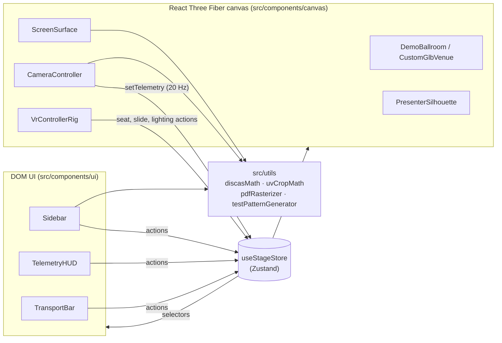
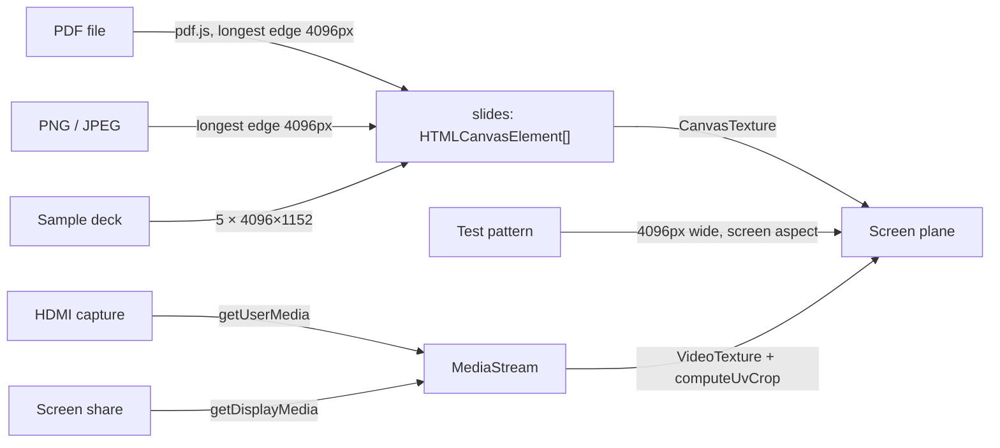

# Architecture

StageSight 3D is a client-only single-page app. There is no backend. Every upload (PDF, image, `.glb`), capture stream and screen share stays in the browser tab, and the production build is a static bundle served from GitHub Pages.

## Overview

`App.tsx` stacks four layers in one full-viewport container: the 3D `StageCanvas` at the back, with `TelemetryHUD` (top), `Sidebar` (left) and `TransportBar` (bottom) floating over it.

## State: one Zustand store

All app state lives in [`src/store/useStageStore.ts`](../src/store/useStageStore.ts). Components never pass state to each other through props. Each one picks the slices it needs.

| Slice | Holds |
| --- | --- |
| Venue | Source (`default-ballroom` or `custom-glb`), the uploaded blob URL, stage height, room size, lighting preset and intensities |
| Screen | Width and height in meters, world position and rotation, gizmo toggle, mesh-picking state and the bound mesh name |
| Content | Source type, rasterized slide canvases, current slide, the live `MediaStream`, and the UV crop mode and its manual values |
| Camera | Orbit or seated navigation, seat position and FOV mode |
| VR | Support and presenting flags, HUD visibility, a recenter counter, and the session toggle function |
| Occlusion | Visibility and stage offsets for the presenter, lectern and panel. Offsets are `[x, z]` from the screen center, z toward the audience. The defaults (presenter `[-4, 1.2]`, lectern `[4, 1.2]`, panel `[0, 1]`) don't overlap with all three shown and stay back from the deck's front edge, which is 2m in front of the default screen. |
| Telemetry | The latest `DiscasTelemetry` result |
| UI | Active sidebar tab and whether the sidebar is open |

Three conventions apply:

- **In React render, select narrowly.** Use `useStageStore((s) => s.screenWidth)`, not the whole store, so a component re-renders only when its slice changes.
- **In event handlers, frame loops and listeners, read imperatively.** Use `useStageStore.getState()`. This avoids stale closures and keeps the listener's effect from re-subscribing whenever state changes. `CameraController`'s hotkeys, `applyVideoCrop` in `ScreenSurface` and the VR gamepad polling all do this.
- **Use counters as one-shot signals.** Recentering VR is an event, not a state, so `triggerVrRecenter()` increments `vrRecenterCount` and `VrControllerRig` reacts to the change.

Store actions do the work that has to happen whenever a value changes. For example, `setCustomGlbUrl` revokes the previous blob URL, and `setLightingPreset` sets both intensities.

## The 3D scene

[`StageCanvas.tsx`](../src/components/canvas/StageCanvas.tsx) owns the `<Canvas>`, the background, fog and the fixed lighting rig: a hemisphere fill, an ambient base, three house downlights, a shadow-casting stage key light, a presenter spotlight and two colored side lights. House and stage intensities scale those lights. The children are:

| Component | Responsibility |
| --- | --- |
| [`DemoBallroom`](../src/components/canvas/DemoBallroom.tsx) | Procedural conference ballroom, built from the parts in [`venue/`](../src/components/canvas/venue): carpeted floor, paneled walls with doors and exit signs, a tiled ceiling, the skirted 18m × 5m stage with stairs and drape, theatre-style banquet seating ([`seatingLayout`](../src/utils/seatingLayout.ts)) and optional ceiling trusses. Textures are painted on canvases at startup, so there are no image assets. Clicking the floor picks a spot; clicking a chair sits in it. |
| [`CustomGlbVenue`](../src/components/canvas/CustomGlbVenue.tsx) | Loads the uploaded model with `GLTFLoader` inside an error boundary. If loading fails, the app falls back to the ballroom and releases the blob. Handles click-to-sit and click-to-bind for the screen mesh. |
| [`ScreenSurface`](../src/components/canvas/ScreenSurface.tsx) | The screen: bezel, unlit display plane and underglow. Builds the texture for the active content source and attaches the translate gizmo. |
| [`PresenterSilhouette`](../src/components/canvas/PresenterSilhouette.tsx) | Occlusion props: standing presenter, lectern and four-person seated panel. |
| [`CameraController`](../src/components/canvas/CameraController.tsx) | Orbit controls, seated look-around, FOV switching, desktop hotkeys and the telemetry loop. |
| [`VrControllerRig`](../src/components/canvas/VrControllerRig.tsx) | WebXR session, seated head calibration, controller rays and teleporting, gamepad bindings and the in-headset HUD. |

### Units and coordinates

- **Units are meters.** Screen sizes, seat positions and venue dimensions are physical, and the D/H ratio only means something if they stay that way. A custom model has to be authored in meters, because it is loaded at its native scale.
- **Y is up and the audience sits toward +Z.** The screen faces +Z by default. The default screen is centered at `[0, 3.4, -12]`, and seats run from `z = -8` (front row) to `z = 13` (back of the room).
- **The seated eye is 1.2m above the seat floor.** Desktop seated mode and VR both use this height, set by `SEATED_EYE_HEIGHT` in `VrControllerRig`. Picking a seat always sets its floor height to `y = 0`.

### Telemetry loop

`CameraController` runs `useFrame` and, at most every 50ms, reads the camera's world position and calls [`computeDiscasTelemetry`](../src/utils/discasMath.ts). The result goes to `setTelemetry`, which `TelemetryHUD` and the VR HUD both render. Because it uses the camera's world position, the same code works in orbit, seated and VR modes. See [Sightline telemetry](sightline-telemetry.md) for the math.

### Navigation modes

- **Orbit.** drei `OrbitControls`, with the polar angle clamped so the camera can't go below the floor.
- **Seated.** Orbit controls are off. The camera sits at the seat's eye height and is aimed at the screen center, and dragging adjusts yaw and pitch. Pitch is clamped to ±72°.
- **VR.** Starting a session switches to seated mode. The camera is reparented to a rig group, and the first valid headset pose is calibrated so that facing forward means facing the stage at 1.2m. A floor guard re-pins the eye only if it drops below 0.6m above the seat.

## Content pipeline

- Rasterizing happens once, on upload. A deck is held as an array of canvases, and changing slides only swaps which canvas backs the texture.
- The UV crop applies only to video sources. It is recomputed on `loadedmetadata` and `resize`, because `videoWidth` is still 0 right after `play()`.
- See [Content sources and cropping](content-sources.md) for limits and crop modes.

## Resource lifecycle rules

Most past bugs here were leaks or lifecycle mistakes, so treat these as invariants:

- **Dispose every texture you create.** `ScreenSurface` creates its texture in an effect and disposes it in that effect's cleanup and when it is replaced. Don't derive textures during render.
- **Release blob URLs.** Route uploaded files through the store action that owns them (`setCustomGlbUrl`), which revokes the previous URL.
- **Stop media tracks.** Before starting a new capture or screen share, stop the old stream's tracks.
- **Destroy pdf.js documents.** `rasterizePdf` calls `pdfDoc.destroy()` in a `finally`, which frees the worker's caches.
- **Bind gizmos to the group, not the mesh.** `TransformControls` writes parent-local coordinates. The screen group sits at the scene root, so its local position is its world position.
- **Global shortcuts must ignore form fields.** Keyboard handlers return early when focus is on an `INPUT`, `TEXTAREA` or `SELECT`.

## Known gaps

These are in the code today. Fix them or document them; don't rely on them silently.

- **Screen rotation can't be set from the UI.** `screenRotation` exists and the telemetry math honors its Y component, but no control calls `setScreenRotation`, so it is always `[0, 0, 0]`.
- **`screenMode` is unused.** The `'procedural' | 'mesh-bind'` field and its setter are never read or written outside the store. Mesh binding only copies the picked mesh's size and center into the procedural screen.
- **`showPresenterSilhouette` is a legacy alias.** Its setter also sets `showPresenter`, and nothing else reads it.
- **Seats are always on a flat floor at `y = 0`,** even in a custom venue. Raked seating and balconies aren't modeled.
- **The seat presets assume the demo ballroom's layout.** In a custom venue they use the same coordinates.
