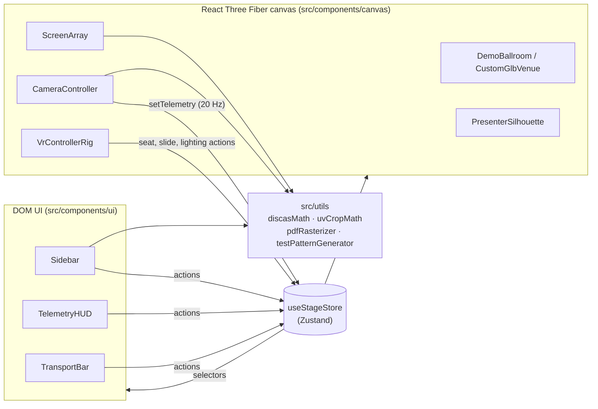
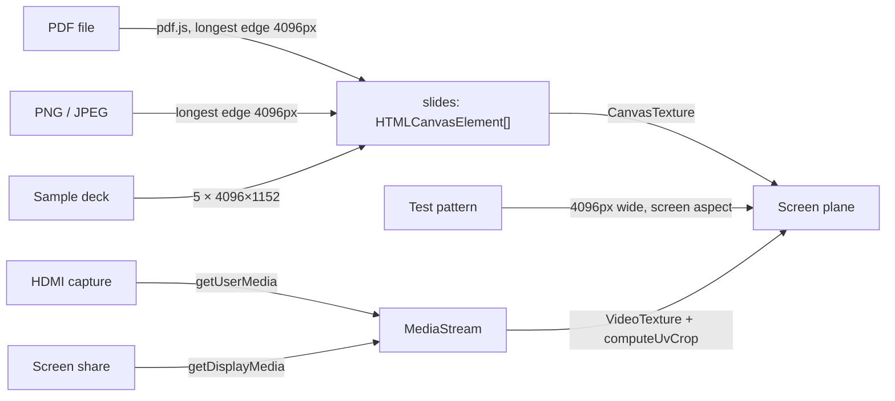

# Architecture

StageSight 3D is a client-only single-page app. There is no backend. Every upload (PDF, image, `.glb`), capture stream and screen share stays in the browser tab, and the production build is a static bundle served from GitHub Pages.

## Overview

`App.tsx` stacks four layers in one full-viewport container: the 3D `StageCanvas` at the back, with `TelemetryHUD` (top), `Sidebar` (left) and `TransportBar` (bottom) floating over it.

## State: one Zustand store

All app state lives in [`src/store/useStageStore.ts`](../src/store/useStageStore.ts). Components never pass state to each other through props. Each one picks the slices it needs.

| Slice | Holds |
| --- | --- |
| Venue | Source (`default-ballroom` or `custom-glb`), the uploaded blob URL, the custom venue's quarter-turn `venueYaw` and deck height (`customDeckHeight`), the four hand-placed `customSeatViews`, the measured `customVenueBounds`, the floor plan's open flag, selected slot and cut height, the ballroom's stage height, room size, lighting preset and intensities |
| Screens | `screens`: a list of `StageScreen` (`id`, `name`, `width` and `height` in meters, `position`, `rotation`, `role` of `'split'` or `'repeat'`, `boundMeshName`). Also `primaryScreenId` (the telemetry reads from it), `selectedScreenId` (the one the size inputs and gizmo act on), `splitOrder` (ids left to right, or null for auto by X) and `demoSideScreens`. `selectPrimaryScreen` and `selectSelectedScreen` return the screens. There is always at least one. Also the gizmo toggle and mesh-picking state |
| Content | Source type, rasterized slide canvases, current slide, the live `MediaStream`, and the UV crop mode and its manual values |
| Camera | Orbit or seated navigation, seat position, the seated heading (`seatYaw`, null means face the screen) and FOV mode. `getActiveSeatPresets` returns the ballroom's fixed seats or the custom venue's placed views |
| VR | Support and presenting flags, HUD visibility, a recenter counter, and the session toggle function |
| Occlusion | Visibility and stage offsets for the presenter, lectern and panel. Offsets are `[x, z]` from the screen center, z toward the audience. The defaults (presenter `[-4, 1.2]`, lectern `[4, 1.2]`, panel `[0, 1]`) don't overlap with all three shown and stay back from the deck's front edge, which is 2m in front of the default screen. |
| Telemetry | The latest `DiscasTelemetry` result |
| Room file | `roomName`, `roomNotes` and `roomBaseline` (the `roomKey` at the last save or open; `hasUnsavedRoomChanges` compares against it). `saveRoom` and `loadRoom` read and write `.stagesight` files through the pure serialiser in [`roomFile`](../src/utils/roomFile.ts). See [Room files](#room-files) |
| Storyboard | `storyboardSets` (each a label and frames: the `CameraShot`, a JPEG blob and its object URL), `isStoryboardOpen`, `isCapturing`, `storyboardExtraShots`, and the `renderStoryboardShots` and `getLiveCameraPose` functions registered by the canvas. Capture, retake, delete and clear actions own the frames' object URLs. See [Storyboard capture](#storyboard-capture) |
| UI | Active sidebar tab and whether the sidebar is open |

Three conventions apply:

- **In React render, select narrowly.** Use `useStageStore((s) => selectSelectedScreen(s).width)`, not the whole store, so a component re-renders only when its slice changes.
- **In event handlers, frame loops and listeners, read imperatively.** Use `useStageStore.getState()`. This avoids stale closures and keeps the listener's effect from re-subscribing whenever state changes. `CameraController`'s hotkeys, the video crop in `ScreenArray` and the VR gamepad polling all do this.
- **Use counters as one-shot signals.** Recentering VR is an event, not a state, so `triggerVrRecenter()` increments `vrRecenterCount` and `VrControllerRig` reacts to the change.

Store actions do the work that has to happen whenever a value changes. For example, `setCustomGlbUrl` revokes the previous blob URL, and `setLightingPreset` sets both intensities.

## The 3D scene

[`StageCanvas.tsx`](../src/components/canvas/StageCanvas.tsx) owns the `<Canvas>`, the background, fog and the fixed lighting rig: a hemisphere fill, an ambient base, three house downlights, a shadow-casting stage key light, a presenter spotlight and two side lights, cool and warm in the ballroom and white in an uploaded venue ([`sideLightColours`](../src/utils/sideLightColours.ts)). House and stage intensities scale those lights. The children are:

| Component | Responsibility |
| --- | --- |
| [`DemoBallroom`](../src/components/canvas/DemoBallroom.tsx) | Procedural conference ballroom, built from the parts in [`venue/`](../src/components/canvas/venue): carpeted floor, paneled walls with doors and exit signs, a tiled ceiling, the skirted 18m × 5m stage with stairs and drape, theatre-style banquet seating ([`seatingLayout`](../src/utils/seatingLayout.ts)) and optional ceiling trusses. Textures are painted on canvases at startup, so there are no image assets. Clicking the floor picks a spot; clicking a chair sits in it. Click-to-sit fires on a click, not a press, and only when the floor or chair is the nearest visible thing under the pointer ([`clickToSit`](../src/utils/clickToSit.ts)), so seated look-around drags and clicks on a screen don't move the seat. |
| [`CustomGlbVenue`](../src/components/canvas/CustomGlbVenue.tsx) | Loads the uploaded model with `GLTFLoader` inside an error boundary. If loading fails, the app falls back to the ballroom and releases the blob. Handles click-to-sit and click-to-pick for screen meshes (the first pick binds the default screen, later ones add screens), and publishes the model's world-space bounds as `customVenueBounds`. The model sits in a group turned by `venueYaw`; binding a sideways wall turns it to face +Z ([`venueAlignment`](../src/utils/venueAlignment.ts)). |
| [`ScreenArray`](../src/components/canvas/ScreenArray.tsx) | Replaces the old single `ScreenSurface`. Renders every screen (bezel, unlit display plane, underglow) and builds **one** texture for the active content source. Each panel points its plane's UVs at its own part of that texture, from `computeScreenRegions` in [`screenLayout`](../src/utils/screenLayout.ts), so repeat and split cost one texture. Attaches the translate gizmo to the selected screen. |
| [`PresenterSilhouette`](../src/components/canvas/PresenterSilhouette.tsx) | Occlusion props: two standing presenters, a lectern and a four-person seated panel. The people are rigged models from `public/models/`; the lectern, chairs and tables are built from [`stagePropGeometry`](../src/components/canvas/stagePropGeometry.ts). See [Occlusion props](#occlusion-props). |
| [`FloorPlanView`](../src/components/canvas/FloorPlanView.tsx) | Top-down floor plan for custom venues: an orthographic default camera, a renderer clipping plane for the section cut, and pointer handlers that place and aim the four camera views ([`floorPlan`](../src/utils/floorPlan.ts)). Mounted only while the plan is open, and restores the perspective camera and clears the clipping plane on unmount. |
| [`CameraController`](../src/components/canvas/CameraController.tsx) | Orbit controls, seated look-around, FOV switching, desktop hotkeys and the telemetry loop. |
| [`VrControllerRig`](../src/components/canvas/VrControllerRig.tsx) | WebXR session, seated head calibration, controller rays and teleporting, gamepad bindings and the in-headset HUD. |

### Units and coordinates

- **Units are meters.** Screen sizes, seat positions and venue dimensions are physical, and the D/H ratio only means something if they stay that way. A custom model has to be authored in meters, because it is loaded at its native scale.
- **Y is up and the audience sits toward +Z.** The screen faces +Z by default. The default screen is centered at `[0, 3.4, -12]`, and seats run from `z = -8` (front row) to `z = 13` (back of the room).
- **The seated eye is 1.2m above the seat floor.** Desktop seated mode and VR both use this height, set by `SEATED_EYE_HEIGHT` in `VrControllerRig`. Picking a seat always sets its floor height to `y = 0`.

### Occlusion props

The lectern, the panel's tub chairs and its side tables are procedural, built from three.js primitives in [`stagePropGeometry.ts`](../src/components/canvas/stagePropGeometry.ts). The people are two low-poly rigged models, a man and a woman (CC-BY, credited in the README), loaded from `public/models/` with `GLTFLoader`. Each prop component loads its own copies and disposes them on unmount, and every figure is a `SkeletonUtils` clone sharing their geometry and materials.

- **Standing.** Each figure is held in the first frame of its model's one animation and scaled to height with its feet on the deck by [`fitToHeight`](../src/utils/presenterPair.ts). [`PRESENTER_PAIR`](../src/utils/presenterPair.ts) sets the pair's spacing and turn.
- **Seated.** The models have no sitting animation, so [`applySeatedPose`](../src/utils/figurePose.ts) bends the standing pose: it points the thighs, shins, upper arms and forearms in set world directions, leans the torso and turns the head. The rigs' feet are IK-style bones outside the leg chain, so each foot is moved to the end of its shin. The hip joints go 0.56m up over the back of the cushion, and each shin angles forward just far enough for its foot to reach the floor. [`PANEL_KINDS`](../src/utils/presenterPair.ts) seats a man, a woman, a man and a woman.

 Each prop faces +Z and stands on its own origin, and the Screen tab's offsets place it relative to the screen. It stands on the ballroom's `stageHeight`, or on `customDeckHeight` in a custom venue.

- **Real scale.** The presenters are a 1.8m man and a 1.68m woman, 0.72m apart and turned slightly in towards each other; the presenter offset places the pair's centre. The lectern is 0.62m wide and 0.5m deep, 1.15m at the front edge of its sloped desk, with its front panel toward the audience and an open back with a shelf. Panelists sit in 0.8m tub chairs with 0.48m seats, at the same heights as the presenters.
- **Merged by material.** The lectern, chairs and tables are each merged into one geometry per material, with colors baked in as vertex colors, so a chair is two draw calls and every material is shared. Each person is about 6,600 triangles in ten skinned meshes, so six people add about 60 draw calls. A unit test holds the panel, people included, under 60k triangles.
- **Built once.** Geometry is built in `useMemo` when a prop mounts and disposed when it unmounts, so toggling a prop rebuilds it and nothing else does.
- **Lighting workarounds.** Skin doesn't receive shadows, and the jaw's normals are tilted up. Without both, the overhead key light darkens every lower face until it reads as a beard.
- **Not scored.** The props are for checking by eye. The telemetry ignores them.

### Telemetry loop

`CameraController` runs `useFrame` and, at most every 50ms, reads the camera's world position and calls [`computeDiscasTelemetry`](../src/utils/discasMath.ts). The result goes to `setTelemetry`, which `TelemetryHUD` and the VR HUD both render. Because it uses the camera's world position, the same code works in orbit, seated and VR modes. See [Sightline telemetry](sightline-telemetry.md) for the math.

### Navigation modes

- **Orbit.** drei `OrbitControls`, with the polar angle clamped so the camera can't go below the floor.
- **Seated.** Orbit controls are off. The camera sits at the seat's eye height and is aimed at the screen center (or along `seatYaw`, for a custom view), and dragging adjusts yaw and pitch. Pitch is clamped to ±72°.
- **VR.** Starting a session switches to seated mode. The camera is reparented to a rig group, and the first valid headset pose is calibrated so that facing forward means facing the stage at 1.2m. A floor guard re-pins the eye only if it drops below 0.6m above the seat.

## Content pipeline

- Rasterizing happens once, on upload. A deck is held as an array of canvases, and changing slides only swaps which canvas backs the texture.
- The UV crop applies only to video sources. It is recomputed on `loadedmetadata` and `resize`, because `videoWidth` is still 0 right after `play()`.
- See [Content sources and cropping](content-sources.md) for limits and crop modes.

## Room files

A `.stagesight` file is a zip (fflate) of `room.json` and, for an uploaded venue, `venue.glb`. [`roomFile.ts`](../src/utils/roomFile.ts) is pure and tested:

- `roomFromState` copies a whitelist of room fields into a `RoomDocument`. Content (slides, streams, device ids, crop) is unreachable from it by design.
- `parseRoomDocument` checks `formatVersion`, refuses a newer one, runs `ROOM_MIGRATIONS` one step at a time from older ones, then validates every field and rebuilds a clean object, so unknown fields are dropped. **Every format bump adds one migration step and a test that loads the previous version.**
- `roomToState` is the store patch to apply. It sets `venueYaw` directly: the saved screens and views are already turned, and `setVenueYaw` would turn them again.

`loadRoom` reads, unpacks, parses and (for a custom venue) fully parses the GLB with [`validateGlb`](../src/utils/glbValidate.ts) before it touches the store, so a bad file changes nothing. The model then goes in through `setCustomGlbUrl`, which revokes the previous blob URL. `validateGlb` disposes everything its trial parse built. `saveRoom` reads the model back from its local `blob:` URL and downloads the file with [`downloadBlob`](../src/utils/download.ts), which revokes its URL. A 220 MB venue zips in about 0.6 s (stored, not compressed), but the browser briefly holds two or three copies of it.

## Storyboard capture

[`storyboard.ts`](../src/utils/storyboard.ts) is pure: the shot list (`storyboardShots`: ballroom presets aimed at the primary screen, or a custom venue's placed views, then extra shots), camera maths (`aimAt`, `directionFromYawPitch`) and the pre-capture checks (`captureWarnings`). [`StoryboardRenderer`](../src/components/canvas/StoryboardRenderer.tsx) lives in the canvas and registers `renderStoryboardShots` in the store:

- Each shot gets its own `PerspectiveCamera`, so the live camera never moves.
- It renders into a `WebGLRenderTarget` at twice the 2400 × 1350 frame size, reads the pixels back and scales them down on a scratch canvas to JPEG 0.85. It never reads the visible canvas.
- The target is flagged `isXRRenderTarget`, the only way three.js applies the renderer's tone mapping and output colour space (and each material's `toneMapped`) off-screen, and its texture is forced to `RGBA8` storage. Without the second step three.js gives it sRGB storage and the GPU encodes twice, washing frames out. With both, frames match the live canvas to within 0.5/255. The flag rules out MSAA (three.js doesn't resolve a multisampled XR target, so it reads back black), hence the supersampling. **Re-check this on every three.js upgrade.**
- Video textures are marked `needsUpdate` before each shot, the floor plan's clipping plane is lifted for the render, and the render target, scratch canvases and object URLs are always released.

[`StoryboardTray`](../src/components/ui/StoryboardTray.tsx) is the review panel. The PDF is built by [`storyboardPdfExport`](../src/utils/storyboardPdfExport.ts), which loads pdf-lib with a dynamic `import()` so it stays out of the main bundle (about 175 kB gzipped, loaded on first export). Page layout, text encoding and the appendix rows are pure, in [`storyboardPdf`](../src/utils/storyboardPdf.ts).

## Resource lifecycle rules

Most past bugs here were leaks or lifecycle mistakes, so treat these as invariants:

- **Dispose every texture you create.** `ScreenArray` creates its texture in an effect and disposes it in that effect's cleanup and when it is replaced. Don't derive textures during render.
- **Rebuild a material when its map switches between a still and video.** three.js adds a video's sRGB decode to the shader at compile time, and swapping `map` doesn't recompile. `ScreenArray` keys the display material with [`screenMaterialKey`](../src/utils/screenMaterialKey.ts) so the switch remounts it.
- **Storyboard frames are temporary.** Every frame's object URL is revoked when the frame is retaken or deleted, or when the panel closes or exports (`clearStoryboard`). The renderer disposes its render target and releases its scratch canvases in a `finally`.
- **Release blob URLs.** Route uploaded files through the store action that owns them (`setCustomGlbUrl`), which revokes the previous URL.
- **Stop media tracks.** Before starting a new capture or screen share, stop the old stream's tracks.
- **Destroy pdf.js documents.** `rasterizePdf` calls `pdfDoc.destroy()` in a `finally`, which frees the worker's caches.
- **Bind gizmos to the group, not the mesh.** `TransformControls` writes parent-local coordinates. The screen group sits at the scene root, so its local position is its world position.
- **Global shortcuts must ignore form fields.** Keyboard handlers return early when focus is on an `INPUT`, `TEXTAREA` or `SELECT`.

## Known gaps

These are in the code today. Fix them or document them; don't rely on them silently.

- **Screen rotation still has no UI control.** Picking a mesh now sets a screen's yaw from the mesh's surface and the telemetry math honors it, but nothing lets you turn a screen by hand, so the default screen and any screen you add without a mesh face +Z.
- **`showPresenterSilhouette` is a legacy alias.** Its setter also sets `showPresenter`, and nothing else reads it.
- **Click-to-sit is always on a flat floor at `y = 0`,** even in a custom venue. Camera views placed on the floor plan use the clicked floor height, so use those for raked seating and balconies.
- **VR ignores a custom view's heading.** The headset's first calibration faces the screen.
- **The orbit camera's target is fixed at `[0, 2, -5]`.** After a custom venue is turned, orbit view still circles that point rather than the bound screen.
